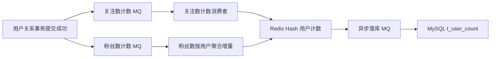

# 17.5 用户关注数、粉丝数计数方案

教程正文：`F:\code\xiaohashu\教程\17 计数服务搭建与开发\17.5 计数方案设计：用户关注数、粉丝数.md`。

## 触发与数据变化

用户关系服务完成关注或取关的数据库事务后，分别发送关注数和粉丝数计数消息。

| 动作 | 原用户 A | 目标用户 B |
| --- | --- | --- |
| A 关注 B | 关注数 +1 | 粉丝数 +1 |
| A 取关 B | 关注数 -1 | 粉丝数 -1 |

## 数据流



Redis Hash 使用 `count:user:<用户ID>` 作为 Key，`followingTotal`、`fansTotal` 分别存储关注总数和粉丝总数。计数通过 `HINCRBY` 增减，例如：

```text
HINCRBY count:user:<用户ID> fansTotal 1
HINCRBY count:user:<用户ID> fansTotal -1
```

## 聚合规则

关注操作受单用户关注上限和手动操作频率约束；粉丝数可能出现热点用户的高并发写入，因此按教程先对粉丝数采用聚合写。

聚合最多收集 1000 条计数操作，同时设置 1 秒时间窗口。满足批量上限或时间窗口时，按目标用户合并增量后写入 Redis，并异步更新数据库。关注记为 `+1`，取关记为 `-1`，同一批次的增量求和，例如 `+1 +1 -1 +1 = +2`。

## 后续小节

17.6 创建两类计数 MQ 消费者；17.7 接入 BufferTrigger 聚合；17.8、17.9 完成粉丝数写 Redis 和入库；17.10 完成关注数写 Redis 和入库。本节为方案记录，不新增业务接口。
