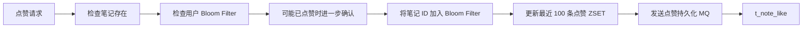

# 18.1 笔记点赞与点赞列表方案

教程正文：`F:\code\xiaohashu\教程\18 计数服务搭建与开发（2）\18.1 笔记点赞、点赞列表方案设计.md`。

## 交互要求

- 用户点赞成功后，前端立即切换红心状态，并在当前笔记详情的点赞数上加一，不再额外请求一次详情。
- 用户只能查看自己的点赞笔记列表。
- 点赞记录最终保存到 MySQL `t_note_like`；接口通过 MQ 异步触发持久化。

## 点赞列表

点赞列表使用 Redis ZSET 缓存最近的记录，按点赞时间排序。缓存保留最近 100 篇笔记，对应每页 10 条的前 10 页；缓存达到 100 条后，新点赞加入 ZSET，并移除最早的一条。超过缓存范围的后续页面从数据库查询。

## 去重方案

| 方案 | 教程分析 | 结论 |
| --- | --- | --- |
| Redis Set | 判断简单，但保存所有笔记 ID 的内存开销较大 | 不采用 |
| Redis Bitmap | 空间占用小，但笔记使用雪花 ID，ID 太长，不适合映射为位图偏移 | 不采用 |
| 直接查询 MySQL | 数据稳定，但高并发下查询和写入压力大 | 不采用 |
| Redis Bloom Filter | 空间开销小；可能把未点赞判断为已点赞，需要进一步确认 | 采用 |

每个用户维护点赞布隆过滤器，存储笔记 ID。布隆过滤器判断为不存在时，可以继续点赞流程；判断为可能存在时，再确认实际点赞记录，避免误判导致拒绝合法点赞。

## 点赞处理流程

1. 检查目标笔记是否存在，不存在则返回“笔记不存在”。
2. 通过用户的布隆过滤器判断笔记是否可能已点赞；可能已点赞时进一步确认，已点赞则返回重复点赞提示。
3. 点赞成功后，将笔记 ID 加入用户的布隆过滤器和点赞 ZSET；ZSET 超过 100 条时移除最早的点赞记录。
4. 发送 MQ，由消费者将点赞记录写入 `t_note_like`。

本节记录点赞接口和列表的方案，不新增业务代码；后续小节按此方案实现点赞、点赞列表及计数功能。
