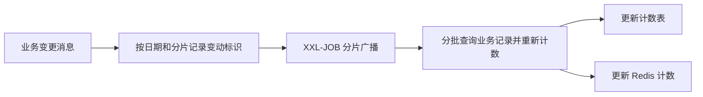

# 19.1 数据对齐方案与表设计

教程正文：`F:\code\xiaohashu\教程\19 数据对齐服务搭建与开发\19.1 数据对齐服务职责说明、方案与表设计.md`。

## 职责

计数 MQ 消费者当前没有完整的幂等处理，重复消费可能使 Redis 和计数表出现误差。数据对齐服务定期从业务记录重新统计，再更新计数表与 Redis，实现最终一致。

## 对齐范围

| 维度 | 计数 | 日增量标识 |
| --- | --- | --- |
| 用户 | 关注数 | user_id |
| 用户 | 粉丝数 | user_id |
| 笔记 | 获得点赞数 | note_id |
| 笔记 | 获得收藏数 | note_id |
| 用户 | 获得点赞数 | user_id |
| 用户 | 获得收藏数 | user_id |
| 用户 | 发布笔记数 | 教程建表示例使用 note_id |

按教程优先核对用户关注的数据：关注数和发布数需要准确；笔记点赞、收藏、粉丝等计数优先关注计数较少的对象，避免全量统计的开销。具体筛选规则在后续任务中实现。

## 日增量与分片

每天记录发生变动的用户或笔记，唯一索引按标识去重。任务预先创建次日的 7 类日增量表，表名遵循 `t_data_align_<计数类型>_count_temp_<yyyyMMdd>_<分片序号>`。

分片序号按标识取模，例如 3 个分片时，`id % 3` 的结果分别写入后缀为 `0`、`1`、`2` 的表。XXL-JOB 在业务低峰通过分片广播分配任务，每个实例分页读取对应分片的数据，核对业务记录并修正计数。

## 表结构

DDL 保存于 `database/19.1-data-align-daily-tables.sql`，保留教程中的 `20241102_0` 日期与分片示例。用户标识或笔记标识均使用非空无符号 BIGINT，并建立唯一索引；自增主键用于后续分批扫描。

19.2 搭建数据对齐服务，19.3、19.4 接入 XXL-JOB，19.5 实现按实际日期预建表，之后逐节实现变更记录、清理与对齐任务。
